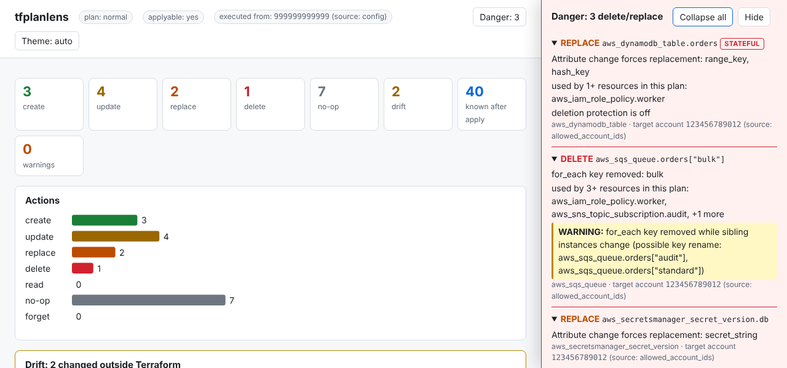
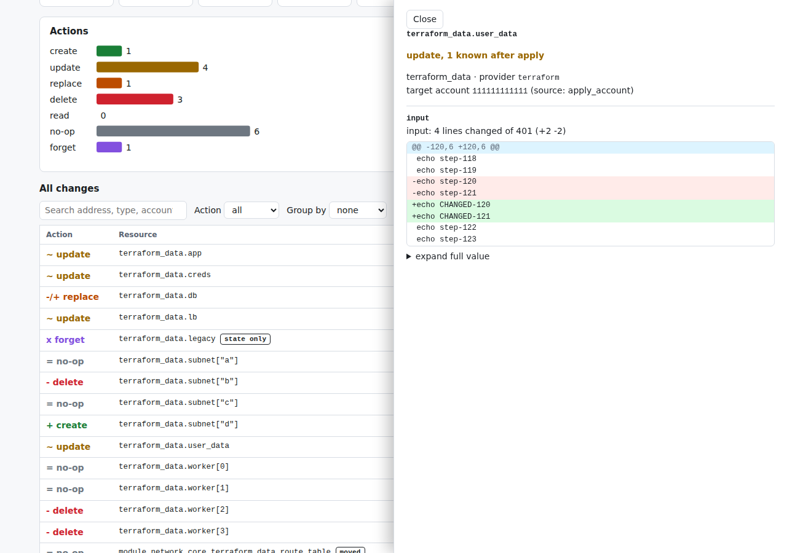

# tfplanlens

Read a Terraform plan the way a reviewer needs to, so a clean-looking plan stops failing at apply.

`tfplanlens` analyzes the JSON from `terraform show -json` **offline**: no AWS credentials, no Terraform binary, no network, no LLM. The output is deterministic. It puts deletes and replaces first with a plain-English reason, shrinks huge values to the lines that changed, never prints sensitive values, and shows which account each resource really lands in.



## Quickstart (about 30 seconds)

```sh
# 1. Install it from a clone (Go 1.23+); see "Install" below
go install ./cmd/tfplanlens

# 2. Turn a plan into JSON
terraform plan -out plan.bin
terraform show -json plan.bin > plan.json

# 3. Read it
tfplanlens report plan.json

# More: a self-contained HTML page, a PR comment, or fail CI on dangerous plans
tfplanlens report plan.json -f html -o report.html
tfplanlens report plan.json -f markdown -o report.md
tfplanlens report plan.json --fail-on delete,replace:aws_db_instance
terraform show -json plan.bin | tfplanlens report -       # stdin works too
```

`--tfapply-account-id` is the account `terraform apply` runs from. You can leave it out: it is inferred from the plan's default provider when possible (see [Accounts](#accounts-where-it-runs-vs-where-resources-land)), and settings can live in a [config file](#config-file). Exit codes: `0` ok, `1` a `--fail-on` rule matched, `2` error.

## Install

tfplanlens is installed from a local clone; there are no published releases and no Homebrew formula.

```sh
git clone https://github.com/aalaydrus/tfplanlens
cd tfplanlens
go install ./cmd/tfplanlens        # installs to $(go env GOPATH)/bin (or $GOBIN)
tfplanlens version                 # e.g. "dev (8814cf7)": the git revision it was built from
```

Make sure `$(go env GOPATH)/bin` is on your `PATH`. To update, `git pull` and run `go install ./cmd/tfplanlens` again. To build a binary in place instead: `go build -o tfplanlens ./cmd/tfplanlens`.

## Why not just read `terraform plan`?

You can, and for a small plan you should. It gets hard when the plan is big or noisy:

- **The dangerous lines are buried.** A delete or a forced replacement is one line among hundreds. tfplanlens lists every delete and replace first, with the reason in plain English ("count shrank; index 2 no longer exists", "for_each key removed: b", "Resource is tainted", "Attribute change forces replacement: triggers_replace"), a **STATEFUL** badge for databases, buckets, volumes and the like, and a warning when a `count`/`for_each` change looks like an accidental index shift.
- **Long values bury everything else.** In one real plan I measured (the `complex` scenario in `testdata/real`), Terraform's output was 105 lines, 25,835 characters, with a single line of **14,705 characters**: a base64 `user_data` shown before and after. The tfplanlens text report for the same plan was 58 lines (57 with an apply account given; longest 114 characters) and shows the decoded change as 2 removed and 2 added lines out of 401, with 2 lines of context. That is a summary, not a replacement: it does not list unchanged attributes or every create.
- **Known-after-apply noise.** Computed attributes that will change are counted per resource, not printed.
- **Secrets can leak through copies.** In that same real plan, Terraform marked a variable's `input` sensitive, but the computed `output` copy (the old secret) was printed in clear by `terraform plan` itself. tfplanlens masks any value equal to a sensitive sibling in the same resource. It is a heuristic and only covers copies within one resource.
- **Which account is this going to?** With role-assuming providers, the account a resource lands in is not the one you run from. tfplanlens shows both, and where each answer came from.
- **Drift, moves, imports and `removed` blocks** are called out instead of looking like deletes and creates.

## What a report looks like

The HTML report is one file with no external requests (works offline, dark mode). Each resource opens a drawer with its attribute diffs; this is the decoded 400-line `user_data` change:



The markdown report is built for PR comments: a summary table, the Danger section expanded, everything else in collapsible `<details>` per account then module, capped at 60,000 characters. This is the top of the one produced for that same plan (the full report is in [docs/readme/sample-pr-comment.md](docs/readme/sample-pr-comment.md)):

<details>
<summary>Sample PR comment (summary and Danger section)</summary>

**tfplanlens plan report**

| | |
|---|---|
| Plan | normal, applyable: yes, errored: no |
| Executed from (apply account) | `111111111111` (source: flag) |
| create | 1 |
| update | 4 |
| replace | 1 |
| delete | 3 |
| no-op | 6 |
| forget | 1 |
| Drift | 0 |
| Known after apply | 10 attribute(s) |

**Danger**

| Action | Resource | Why | Target account |
|---|---|---|---|
| **REPLACE** | `terraform_data.db` | `Attribute change forces replacement: triggers_replace` | `111111111111` (source: apply_account) |
| **DELETE** | `terraform_data.subnet["b"]` | `for_each key removed: b`<br>**WARNING:** `for_each key removed while sibling instances change (possible key rename: terraform_data.subnet["d"])` | `111111111111` (source: apply_account) |
| **DELETE** | `terraform_data.worker[2]` | `count shrank; index 2 no longer exists` | `111111111111` (source: apply_account) |
| **DELETE** | `terraform_data.worker[3]` | `count shrank; index 3 no longer exists` | `111111111111` (source: apply_account) |

</details>

## Waves and instance groups

Every report ends with apply and destroy **waves** worked out from the
configuration's references and `depends_on`: wave 1 has no dependency on another
changing resource, wave 2 depends only on wave 1, and so on (destroys run in
reverse). Terraform applies in parallel, so this shows possible parallelism, not a
strict order, and it is a lower bound because `local.*` references and
`replace_triggered_by` are not in the plan JSON (the report says so when it
applies). A dependency cycle is flagged prominently. `count` and `for_each`
resources are listed once with their keys, and the HTML report can group the table
by resource.

## What changed since the last plan

```
tfplanlens diff before.json after.json
tfplanlens diff before.json after.json -f markdown -o diff.md
tfplanlens diff before.json after.json --fail-on-new-danger
```

Compares two plans of the same configuration by resource address and tells you only what the new push changed: resources that are **only in the new plan**, ones that **no longer change**, and ones that change **differently** (action, reason, target account, and which attributes). It calls out anything the new plan now deletes or replaces that the old one did not (`--fail-on-new-danger` exits 1 on that, after printing the diff), anything that is no longer deleted or replaced, and drift that appeared or went away. A plain no-op counts as "not changing". Formats: text, markdown (for a PR comment) and json. Sensitive values are never compared, so two sensitive changes to the same attribute count as equal.

## Interactive terminal view

```
tfplanlens tui plan.json
```

An expandable tree of the changes: `→`/enter expands a resource to its reason, warnings and attribute diffs, and `count`/`for_each` instances sit under one parent row. `/` searches, `f` cycles the action filter, `g` groups by account or module, `n` shows plain no-ops, `w` switches to the waves view, `e`/`c` expand or collapse everything, `q` quits. It needs a terminal (use `report` for pipes and files) and takes the same `--config`, `--tfapply-account-id` and `--account` options as `report`.

## Accounts: where it runs vs where resources land

Plans are often applied from a runner in an automation account that assumes roles into target accounts. The report shows both:

- **Apply account** ("executed from"): where `terraform apply` runs.
- **Target account**, per provider, with the source that decided it. Every resource whose target differs from the apply account is flagged.

You usually do not need to configure anything: both default to what the plan's own provider configuration says. The plan JSON does not include the backend, so anything it cannot tell you goes in `tfplanlens.config.yaml` (see [Config file](#config-file)).

### Apply account

Highest precedence first:

| # | Source | How |
|---|---|---|
| 1 | flag | `--tfapply-account-id 999999999999` |
| 2 | env var | `TFPLANLENS_TFAPPLY_ACCOUNT_ID=999999999999` |
| 3 | config file | `tfapply_account_id: "999999999999"` |
| 4 | inferred | the account of the **default (unaliased) provider**, if that provider has no `assume_role` (found as in the target-account table below) |
| 5 | unknown | the report says so in one notice; cross-account flags are off |

Nothing is asked and nothing is written to stderr. Use `--fail-on unresolved` in CI if an unknown account should fail the build.

### Target account

Resolved per provider, first match wins; the report shows which source was used:

| | Source | Shown as |
|---|---|---|
| a | `--account alias=id` (repeatable; overrides everything below) | `flag` |
| b | `accounts:` in the config file | `config` |
| c | `assume_role.role_arn`, literal or resolved through the plan's `variables` | `role_arn`, `role_arn_variable` |
| d | a single value in `allowed_account_ids` | `allowed_account_ids` |
| e | `account_id` of an `aws_caller_identity` data source in `prior_state` | `caller_identity` |
| f | providers with no `assume_role` run as the apply account | `apply_account` |
| g | otherwise | `unresolved` |

A resource whose own ARN-typed attributes (`arn`, `*_arn`, `*_arns`) name a different account than its provider's target gets a warning.

## Usage

```
tfplanlens report <plan.json|-> [flags]
tfplanlens version

  -f, --format <text|html|markdown|json>   output format; repeatable (default text)
  -o, --out <path>                         write to a file instead of stdout
  -c, --config <path>                      config file (default ./tfplanlens.config.yaml if present)
      --fail-on <rules>                    exit 1 on: delete, replace, drift, unresolved, or kind:type
      --tfapply-account-id <id>            account terraform apply runs from
      --account <alias=id>                 target account for a provider alias; repeatable
      --no-color
```

Exit codes: `0` ok, `1` a `--fail-on` rule matched, `2` error.

`--fail-on` takes comma-separated rules: `delete`, `replace`, `drift`, `unresolved` (any account the report could not determine), and `kind:type` to scope the first three, e.g. `replace:aws_db_instance`.

## Config file

Everything else lives in an optional `tfplanlens.config.yaml` in the directory you run from (or the file given with `-c`). Flags override it. [tfplanlens.config.yaml](tfplanlens.config.yaml) in this repo is a commented template with every key; copy it next to your Terraform code.

```yaml
tfapply_account_id: "999999999999"   # where terraform apply runs (else inferred from the default provider)
accounts:                            # provider alias or key (aws.prod) -> account
  prod: "111111111111"
format: [text]                       # default output format(s)
fail_on: [delete, "replace:aws_db_instance"]
max_line: 120                        # terminal truncation width
stateful_types: [aws_rds_cluster]    # added to the built-in list
long_value_keys: [custom_script]     # added to the built-in list
ignore_types: []                     # hidden from the report, never from --fail-on
```

Unknown keys and invalid values are errors, so a typo cannot silently do nothing.

## Output formats

| Format | What you get |
|---|---|
| `text` | colored terminal report: Summary, Danger, Drift, Changes by account, Changes by module |
| `markdown` | for PR comments: summary table, Danger expanded, the rest in `<details>` per account then module; capped at 60,000 characters |
| `html` | one self-contained file (no CDN, works offline, dark mode): Danger panel, tiles, chart, searchable and groupable table, per-resource detail drawers |
| `json` | the analysis as stable JSON, see [docs/json-schema.md](docs/json-schema.md) |

Every format shows the apply account and each resource's target account with the source that decided it.

## Releases

There are no published releases. `.goreleaser.yaml` and `.github/workflows/release.yml` are in place (binaries for linux, darwin and windows, checksums, and an optional Homebrew formula if a tap and token are ever configured), but nothing is tagged. A tag `v*` would run them; CI already runs `goreleaser check` and a snapshot build on every pull request.

## Smoke tests on real plans

`.github/workflows/smoke.yml` runs tfplanlens against real Terraform plans. For each scenario under `testdata/real/`, `scripts/smoke-plan.sh` applies `v1`, swaps in `v2`, and runs `terraform plan` (optionally with extra flags from `plan-args`, and an out-of-band step from `between.sh`). It then renders every format, takes screenshots (`scripts/screenshot.mjs`), and commits the outputs under `docs/smoke` and `docs/screenshots`.

| Scenario | Covers |
|---|---|
| `simple` | create, update, replace (`triggers_replace`), delete (removed from config) |
| `complex` | `for_each` and `count` deletes, a `removed` block, a moved module, a sensitive variable, a 400-line base64 `user_data` |
| `destroy` | `plan -destroy` |
| `import` | an `import` block plus an update |
| `reasons` | `replace_by_triggers`, `replace_by_request` (`-replace`), `replace_because_tainted`, `delete_because_wrong_repetition`, `delete_because_no_module`, an implicit single-to-`count` move |
| `drift` | resources deleted or tampered with outside Terraform, then planned |
| `refresh-only` | `plan -refresh-only` (no `resource_changes` at all) |
| `module-provider` | a module handed `providers = { local = local.alt }` |
| `aws-assume-role` | the real AWS provider with `assume_role` (a literal and a variable-based role ARN), an alias without `assume_role`, an alias pinned with `allowed_account_ids`, a module handed an aliased provider, `aws_caller_identity` in `prior_state`, and a genuinely cross-account ARN. Runs against [floci](https://floci.io/floci/), a local AWS emulator, so it needs no AWS credentials. |

Most scenarios use only the built-in `terraform_data` resource; `drift`, `refresh-only` and `module-provider` also use the credential-free `hashicorp/local` provider. `aws-assume-role` uses the real AWS provider against floci (`docker run -p 4566:4566 floci/floci`); `scripts/smoke-plan.sh` seeds the IAM roles it assumes (`scripts/floci-seed.sh`) and skips the scenario with a message if floci is not running. Floci keeps state, so restart it between local runs of that scenario. To run one locally you need Terraform >= 1.7:

```sh
go build -o tfplanlens ./cmd/tfplanlens
scripts/smoke-plan.sh reasons
scripts/smoke-report.sh reasons testdata/plans/real/reasons-tf*.json
```

The tests in `cmd/tfplanlens/real_plans_test.go` assert on these plans by address, action and count (never byte-exact: every run produces new resource UUIDs).

## License

MIT
