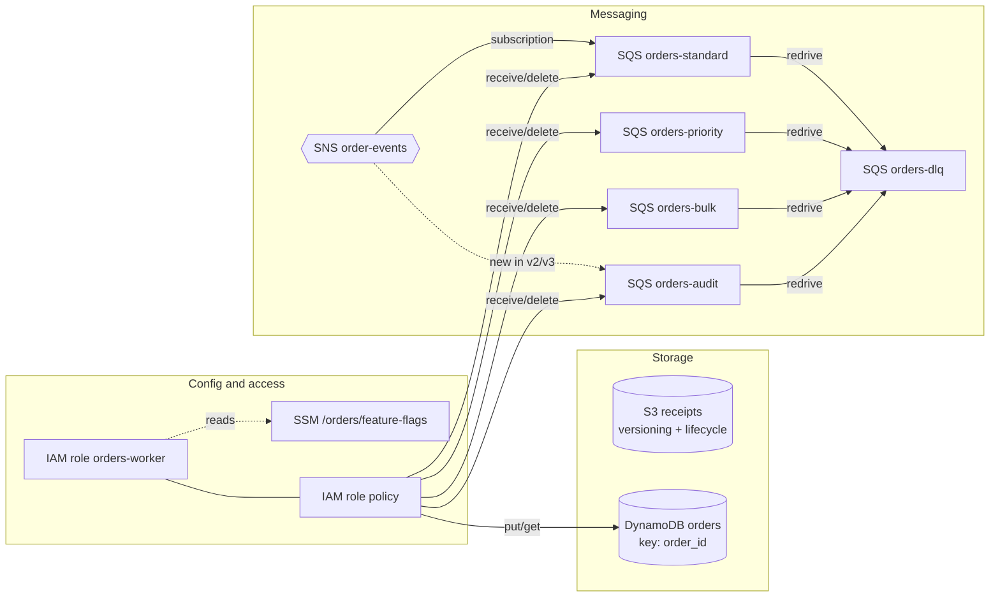

# Orders platform (simulation)

A small, made-up order-processing stack. Everything runs in one AWS workload
account (`123456789012`); Terraform is applied from a separate CI account
(`999999999999`). The Terraform for each version is in [`terraform/`](terraform/).

## The three versions

| Version | What it is | Notable changes from the one before |
|---|---|---|
| [`v1-deployed`](terraform/v1-deployed/main.tf) | What runs in production. Its state is [`input/terraform.tfstate`](input/terraform.tfstate). | |
| [`v2-proposed`](terraform/v2-proposed/main.tf) | A pull request. Plan: [`input/plan.json`](input/plan.json). | DynamoDB table re-keyed by `customer_id` (replaces the table); `bulk` queue removed; `audit` queue and subscription added; `standard` visibility timeout 30s to 60s; S3 lifecycle rule; feature flag on; IAM policy updated. |
| [`v3-revised`](terraform/v3-revised/main.tf) | The same PR after review. Plan: [`input/plan-revised.json`](input/plan-revised.json). | Keeps the table key and adds an index instead (update in place); keeps the `bulk` queue. |

## Where the plans came from

`input/plan.json` and `input/plan-revised.json` are real `terraform show -json`
output (Terraform 1.16, AWS provider 6.x) from planning v2 and v3 against the
state of v1. v1 was applied to floci, a
local AWS emulator, so no real AWS account was involved. [`../regenerate.sh`](../regenerate.sh)
recreates them.
