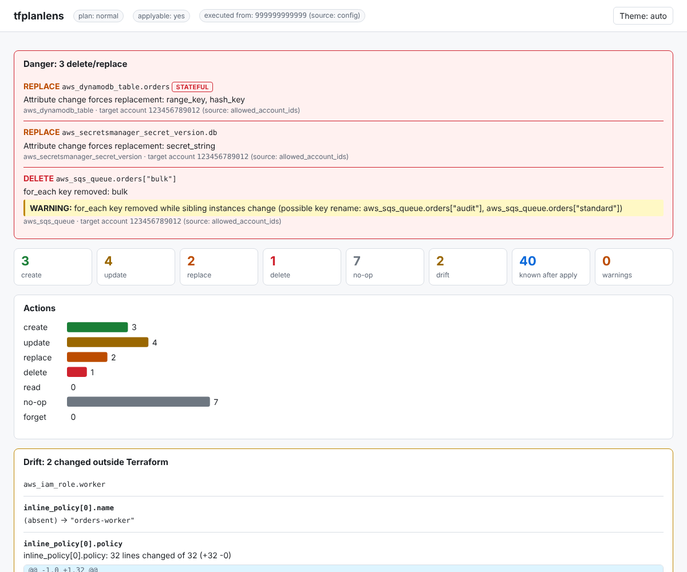
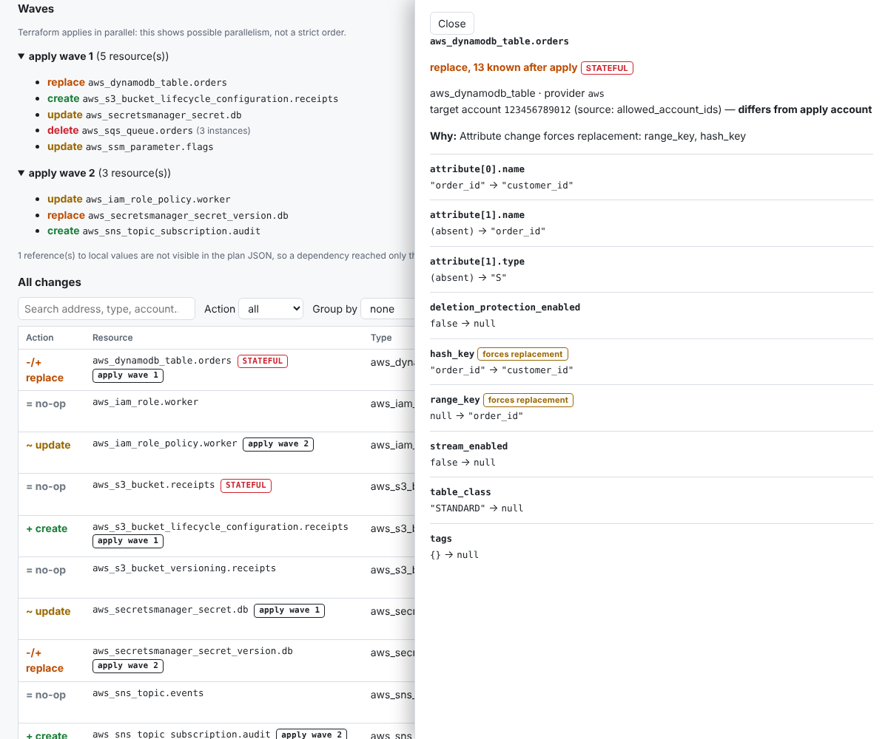

# Example rundown: reviewing a plan with tfplanlens

A start-to-finish walkthrough on a made-up AWS stack. You do not need
Terraform, AWS or a network: the plans are already in
[`../assets/input`](../assets/input), and every output shown here is in
[`../output`](../output).

## The scenario in one minute

An orders platform (S3, DynamoDB, SNS, SQS, Secrets Manager, IAM, SSM; diagram in
[`../assets/ARCHITECTURE.md`](../assets/ARCHITECTURE.md)). Production runs
**v1**. A pull request proposes **v2**. Terraform runs from a CI account
(`999999999999`) into the workload account (`123456789012`).

```
simulation/
  assets/
    ARCHITECTURE.md        the stack, with a mermaid diagram
    terraform/             v1-deployed, v2-proposed, v3-revised
    input/                 terraform.tfstate, plan.json (v2), plan-revised.json (v3)
  rundown/EXAMPLE_RUNDOWN.md   you are here
  output/                  what tfplanlens produced (generated by demo.sh)
  tfplanlens.config.yaml   tells tfplanlens which account Terraform runs from
  demo.sh                  runs every step below; regenerate.sh rebuilds the plans
```

## Step 1: build the tool

```
go build -o tfplanlens ./cmd/tfplanlens
```

## Step 2: get a plan as JSON

This is the only thing tfplanlens needs; it never touches AWS or Terraform.
In a real repo you would run:

```
terraform plan -out=plan.bin
terraform show -json plan.bin > plan.json
```

Here that is already done: [`assets/input/plan.json`](../assets/input/plan.json).
Go to the simulation folder for the rest: `cd simulation`.

## Step 3: read the report

```
tfplanlens report assets/input/plan.json
```

The apply account comes from `tfplanlens.config.yaml` (a plan cannot know where
it will be applied from). The part to read first is **Danger**, full output in
[`output/report.txt`](../output/report.txt):

```
== Summary ==
Executed from (apply account): 999999999999 (source: config)
Actions: create 3, update 4, replace 2, delete 1, read 0, no-op 8, forget 0

== Danger ==
! REPLACE aws_dynamodb_table.orders [STATEFUL]
    type: aws_dynamodb_table | target account: 123456789012 (source: allowed_account_ids)
    why: Attribute change forces replacement: range_key, hash_key
! REPLACE aws_secretsmanager_secret_version.db
    why: Attribute change forces replacement: secret_string
! DELETE aws_sqs_queue.orders["bulk"]
    why: for_each key removed: bulk
    WARNING: for_each key removed while sibling instances change (possible key rename: aws_sqs_queue.orders["audit"], ...
```

What to notice:

- The PR looks like "add an index and tidy some queues", but one line in it
  **destroys and recreates the production orders table**. That is the finding a
  plain `terraform plan` buries on page three.
- Rotating the database password (a new `secret_string`) is a **REPLACE** of
  `aws_secretsmanager_secret_version`, not an in-place update: with this AWS
  provider the old version is destroyed and a new one created. It is listed as
  danger because it is a replace, but it is the routine part of this PR, which is
  why it is on the list of cases to refine
  ([`field-notes`](../../field-notes/WISHLIST.md)). The password itself is never
  printed: it shows as `(sensitive value changed)`, even though `plan.json`
  holds it in plain text (see [`field-notes`](../../field-notes/TERRAFORM_GOTCHAS.md)).
- The `bulk` delete carries a warning: a queue key was removed while another
  key was added, which is how an accidental rename looks.
- The target account (`123456789012`) was read from the provider's
  `allowed_account_ids`, and the report flags that it **differs from the apply
  account**.
- **Drift** lists two things nobody changed: the AWS provider fills in
  `inline_policy` and `versioning` when it refreshes. It is a known provider
  quirk, shown because the report cannot tell it from a real out-of-band change.

Lower down, **Waves** shows what could run in parallel (the table, the
lifecycle rule and the flag first; the IAM policy and the new subscription only
after the new queue exists), and the queue is listed once with its keys:

```
apply wave 1: replace aws_dynamodb_table.orders, create ...lifecycle..., update aws_ssm_parameter.flags, ...
apply wave 2: update aws_iam_role_policy.worker, create aws_sns_topic_subscription.audit
aws_sqs_queue.orders [for_each]: audit (create), bulk (delete), priority (no-op), standard (update)
```

## Step 4: the HTML report

```
tfplanlens report assets/input/plan.json -f html -o report.html
```

One self-contained file (no network needed): search, filter by action, group by
account, module or resource, and click a resource for its attribute diffs.
[`output/report.html`](../output/report.html)




## Step 5: the markdown report (for a pull request comment)

```
tfplanlens report assets/input/plan.json -f markdown -o report.md
```

Danger expanded, everything else in collapsible sections, capped to fit a
GitHub comment: [`output/report.md`](../output/report.md).

## Step 6: gate the pipeline

```
tfplanlens report assets/input/plan.json --fail-on delete,replace:aws_dynamodb_table
```

The report prints, then the exit code is 1 if a rule matched, so CI can block
the merge. [`output/gate-stderr.txt`](../output/gate-stderr.txt):

```
fail-on: delete matched aws_sqs_queue.orders["bulk"]; replace:aws_dynamodb_table matched aws_dynamodb_table.orders
```

## Step 7: review feedback arrives, compare the new plan

The reviewer asks for the index instead of a re-key, and to keep `bulk`. The
author pushes **v3**; the new plan is `assets/input/plan-revised.json`.

```
tfplanlens report assets/input/plan-revised.json     # Danger: only the password rotation is left
tfplanlens diff assets/input/plan.json assets/input/plan-revised.json
```

The table and the `bulk` queue are no longer in Danger (the password rotation is, as before). The gate now exits 0 (see [`output/gate-exit.txt`](../output/gate-exit.txt)). The
diff tells the reviewer exactly what the push changed, so they need not reread
everything ([`output/diff.txt`](../output/diff.txt), or `-f markdown` for the PR:
[`output/diff.md`](../output/diff.md)):

```
== No longer deleted or replaced ==
aws_dynamodb_table.orders
aws_sqs_queue.orders["bulk"]

== Changed (1) ==
~ replace -> update  aws_dynamodb_table.orders
    action: replace -> update
    attribute now changes: global_secondary_index[0].name
    ...
```

## Step 8: explore interactively

```
tfplanlens tui assets/input/plan.json
```

Arrow keys move, Enter expands a resource to its reason and attribute changes,
`/` searches, `f` filters by action, `g` groups, `w` shows the waves, `q`
quits. A snapshot after pressing Enter on the first row:
[`output/tui-snapshot.txt`](../output/tui-snapshot.txt).

## Run it yourself

```
simulation/demo.sh          # re-runs steps 3 to 7 and rewrites simulation/output
```

To try your own plan, replace the input: `terraform show -json plan.bin > my.json`,
then `tfplanlens report my.json`. Add a `tfplanlens.config.yaml` next to where you
run it to set the apply account, default formats and `--fail-on` rules (start
from the one in the repo root).

## Honest notes

- The AWS here is an emulator (floci) and the stack is invented; the plans are
  real Terraform output, but only for this small set of resource types.
- The IDs, timestamps and the `123456789012`/`999999999999` accounts are fake.
- `regenerate.sh` produces the same shape of plan, not byte-identical files.
